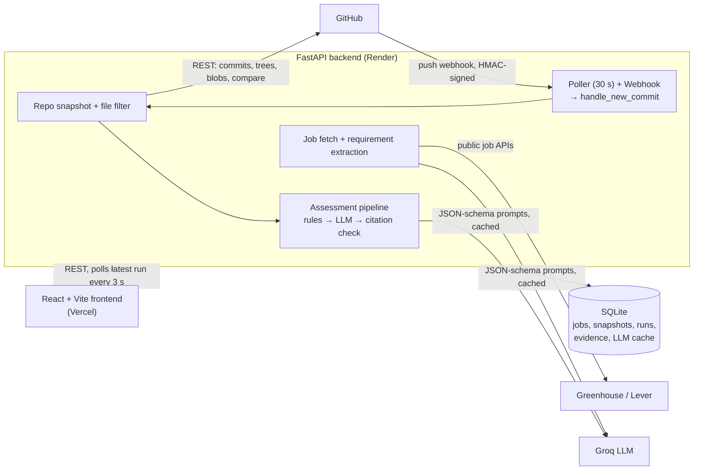
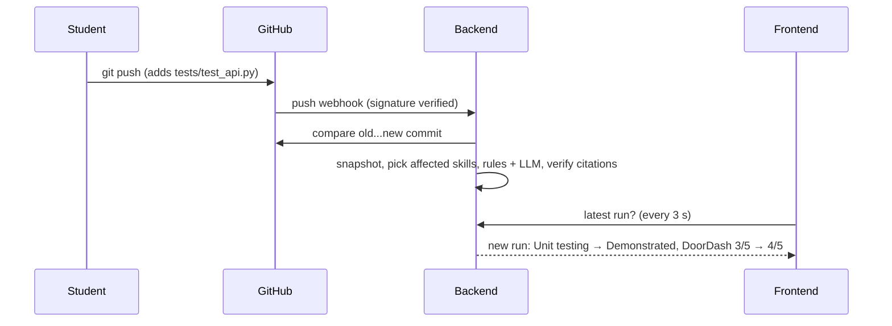

# AI Career Coach

Compares **real job postings** with what a student's **GitHub repository actually demonstrates**, backs every skill
claim with **verifiable evidence** (file + line links), and **re-assesses automatically** when the student pushes a change.

- **Live app:** https://career-coach-gamma.vercel.app
- **API (docs):** https://career-coach-api-j4t8.onrender.com/docs

> "Not demonstrated" never means "the student lacks this skill". It only means no evidence was found in the analyzed
> files of this repository.

## What it does

1. **Job requirements with sources**: paste a Greenhouse or Lever posting URL. The posting is fetched from the public
   API and an LLM extracts the skills. Every requirement keeps an **exact quote**, checked to appear word for word in
   the posting (unverifiable quotes are dropped).
2. **Repository analysis**: connects a public GitHub repo, snapshots the latest commit, and selects the relevant files
   (skips lockfiles, binaries, vendored folders).
3. **Evidence-backed skill assessment**:
   - **Rules first:** file paths, dependencies in manifests, code patterns, and commit history.
   - **LLM review second:** only for skills with a signal. The LLM must cite file + lines, and every citation is
     **verified against the real file**. Invented citations are discarded.
   - Nothing is "demonstrated" without verified evidence. The LLM cannot remove what the rules proved, and if the LLM
     is unavailable it falls back to rules only.
4. **Gap analysis**: joins each job's requirements with the latest assessment (required first, neutral wording).
5. **Automatic re-assessment**: a push to GitHub triggers a **webhook** (instant) and a **poller** (every 30 s,
   fallback). Both run the same pipeline:
   - only the skills affected by the changed files are re-assessed; the rest are carried over
   - the UI shows the commit, the changed files and each status change (e.g. *Unit testing: Not demonstrated →
     Demonstrated*)

## Architecture



**Assessment flow for a new commit**



**Key design choices**

| Choice | Why |
|---|---|
| Rules before LLM | Deterministic, free evidence. The LLM adds depth only where there is a signal. |
| Citation verification (±3 lines drift) | The LLM cannot invent evidence; every link points to real code. |
| LLM cache (hash of prompt + inputs) | The same input never costs tokens twice; re-runs are instant. |
| Skills assessed per commit, not per job | One assessment serves every job; adding a job costs no re-analysis. |
| Incremental re-assessment | A change only re-checks the skills it can affect. |
| One `handle_new_commit` for poll / webhook / "Check now" | One code path; locks and checks prevent double runs. |
| Token budget (per minute + per day) | Stays inside the Groq free tier. |

## Project layout

```
backend/    FastAPI app (app/jobs, app/github, app/analysis, app/assessment, app/llm, app/watch) + tests
frontend/   React + Vite UI (Jobs, Repository, Assessment, Gap analysis)
database/   schema.sql, seed/skills.json (skill taxonomy), seed/demo_data.json (demo seed)
scripts/    reset_demo.ps1, start_tunnel.ps1, export_seed.py
render.yaml Render blueprint for the backend
```

## Run locally (Windows / PowerShell)

Prerequisites: Python 3.12, Node 20+, a [Groq API key](https://console.groq.com) (free), a GitHub token (read-only,
public repos).

```powershell
copy .env.example .env          # then fill in GROQ_API_KEY, GITHUB_TOKEN (and GITHUB_WEBHOOK_SECRET for webhooks)

cd backend
python -m venv .venv
.venv\Scripts\Activate.ps1
pip install -r requirements.txt
uvicorn app.main:app --reload --port 8000

# second window
cd frontend
npm install
npm run dev                     # http://localhost:5173
```

Tests: `cd backend; .venv\Scripts\Activate.ps1; python -m pytest` (citation verification, affected-skill selection,
webhook signature/dedupe).

**Webhook locally:** create a channel on https://smee.io and add a GitHub webhook to the repo (payload URL = the
smee URL, content type JSON, same secret as `.env`, push events). Then run `.\scripts\start_tunnel.ps1 <smee URL>`.
Without it, polling still picks up changes within 30 s.

## Deployment

- **Backend → Render** (free web service, from `render.yaml`). Secrets are set in the Render dashboard:
  `GROQ_API_KEY`, `GITHUB_TOKEN`, `GITHUB_WEBHOOK_SECRET`, and `FRONTEND_ORIGIN` (comma-separated, e.g.
  `http://localhost:5173,https://career-coach-gamma.vercel.app`).
- **Frontend → Vercel** (root directory `frontend`, env `VITE_API_BASE_URL` = the Render URL).
- **Webhook:** `https://<render-url>/api/webhooks/github`.
- The free Render disk is wiped on every restart, so the server **rebuilds its database from
  `database/seed/demo_data.json`** (jobs, requirements, cached LLM answers, demo repo). The demo therefore costs 0
  tokens after a restart. To refresh the seed: `python scripts/export_seed.py`, then commit.

## Demo script (≈3 min)

1. **Jobs:** three real postings (DoorDash, Verkada, General Matter). Every requirement has its source quote and link.
2. **Repository:** `student-api-demo` (FastAPI + SQLAlchemy), with the snapshot and the files analyzed.
3. **Assessment:** each skill shows its status, rationale and evidence; links open the exact lines on GitHub.
4. **Gap analysis (DoorDash): 3 / 5 required.** *Unit testing* is not demonstrated (neutral wording).
5. Live change: `.\scripts\reset_demo.ps1 add` pushes `tests/test_api.py`. Within seconds:
   - the banner shows **Unit testing: Not demonstrated → Demonstrated** and **4 / 5**
   - the evidence links to the new test file
   - the timeline shows trigger `webhook`
6. Reset afterwards: `.\scripts\reset_demo.ps1 reset`.

**Before presenting:**
- [ ] Open the live site a minute early (the free backend sleeps after 15 min idle; waking takes ~50 s).
- [ ] Health pills are green; Gap analysis shows 3 / 5.
- [ ] The demo repo is in the reset state.
- [ ] Fallbacks: the **Check now** button, polling (30 s), or the local setup.

## Limitations

- It assesses **what the repository demonstrates, not who wrote it or how well the student understands it.** Results
  are a starting point for a conversation (e.g. an interview), not a verdict.
- Public repos only, one branch, up to 60 files per snapshot (100 KB each).
- Job postings: Greenhouse and Lever URLs. Other sites need the text pasted.
- The skill taxonomy is a small seed list (17 skills) plus skills the LLM adds from postings.
- Single user, no authentication (out of scope for the MVP).
